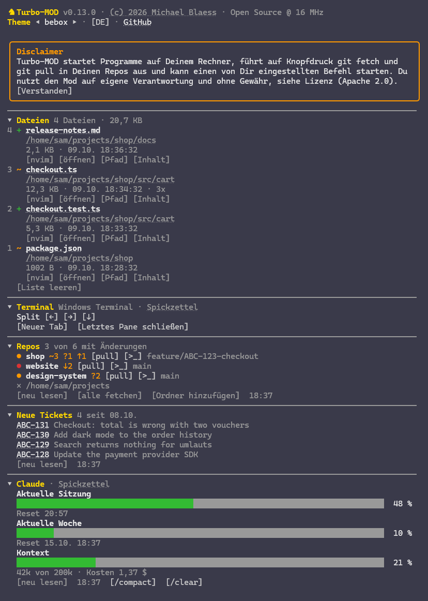
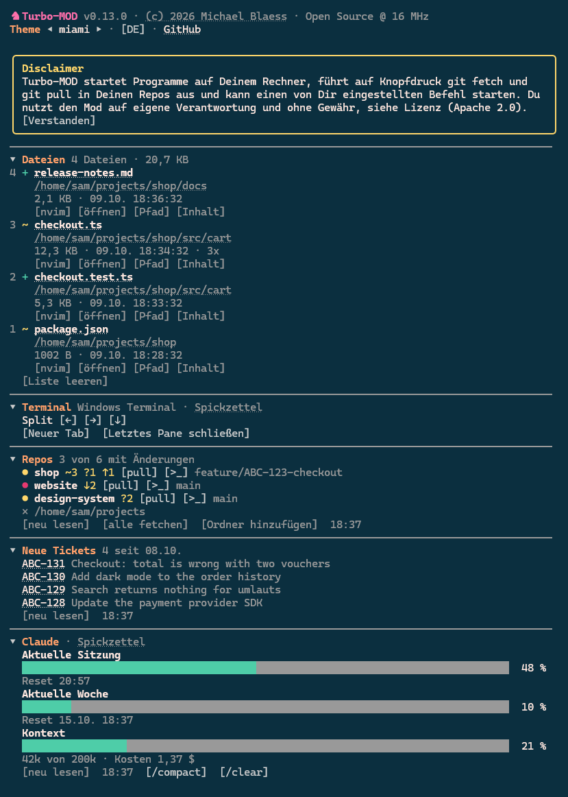
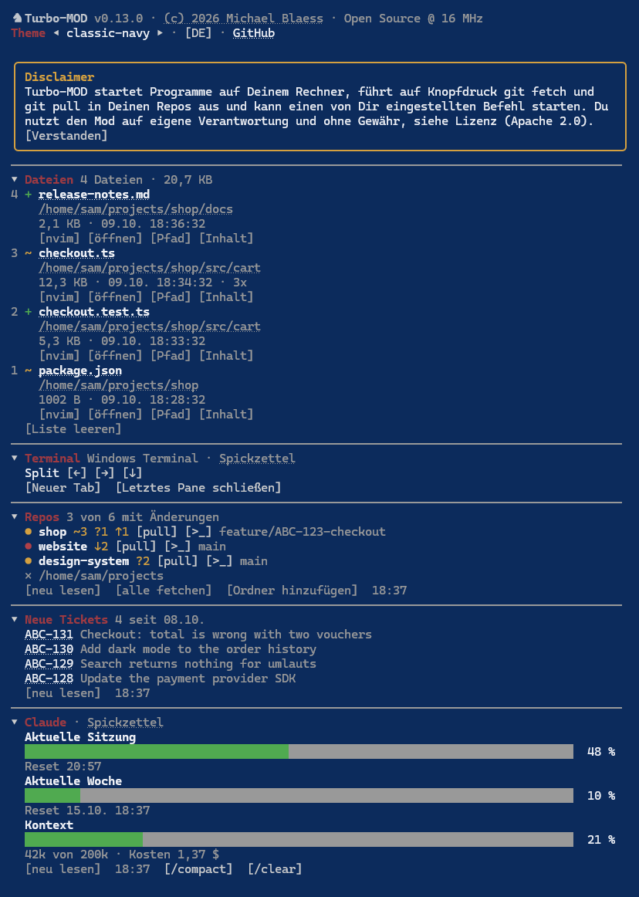
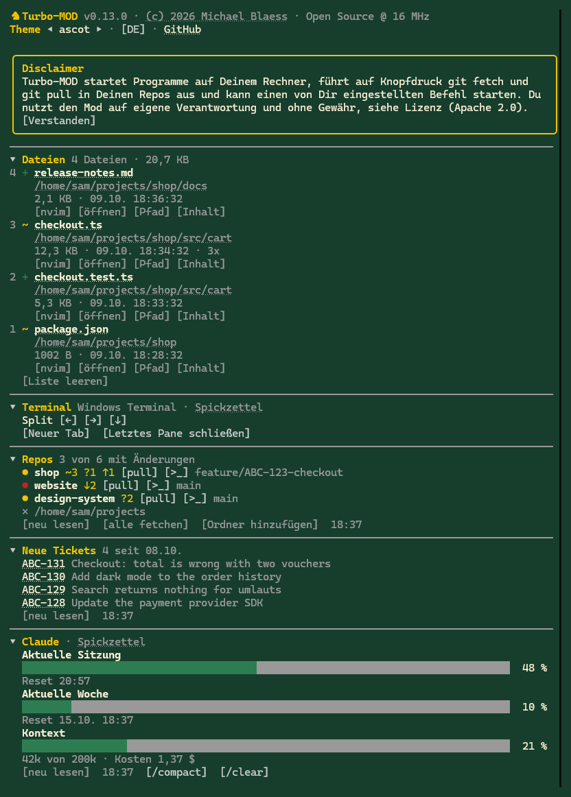
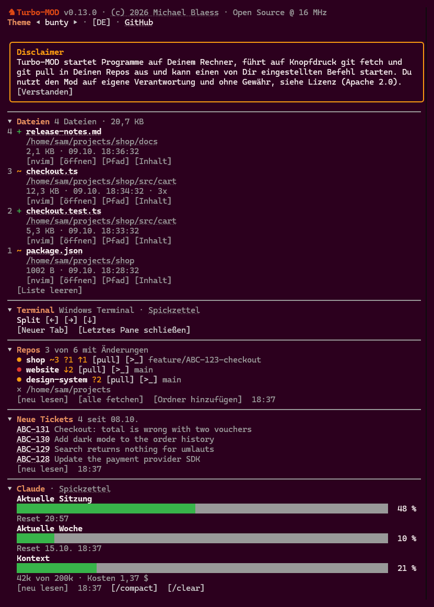

# turbo-mod

<p align="center">
   <a href="README.md">English</a> ·
   <b>Deutsch</b>
</p>

---

Ein Pane für [Claude Code](https://claude.com/claude-code). Es steht rechts neben dem Gespräch
und zeigt, wonach Du sonst immer wieder fragst:

- **Dateien** - jede Datei, die Claude in dieser Sitzung geschrieben hat, mit Knöpfen zum
  Öffnen und Kopieren
- **Terminal** - das Fenster teilen oder einen neuen Tab öffnen, im Ordner, in dem Du arbeitest
- **Repos** - welche Deiner Git-Repos offene Änderungen oder nicht gepushte Commits haben, mit
  einem Pull-Knopf an jedem
- **Claude** - wie viel von Deinen Limits verbraucht ist, wann sie zurückgesetzt werden und wie
  voll der Kontext ist
- **Neue Tickets** - optional, in der Vorgabe aus: neue Tickets aus Deinem Ticketsystem. Braucht
  ein zweites Programm auf Deinem Rechner, für Jira ist das [jira-timesheet](https://github.com/michaelblaess/jira-timesheet)
- **TODO** - eine einfache Liste für Ideen und Erinnerungen. Sie liegt als Markdown-Datei auf
  Deinem Rechner

Dazu kommen 41 Retro-Farbschemata, Englisch und Deutsch als Sprache und ein Titel, der einen
kleinen Texteffekt abspielt.

<p align="center">
  
</p>

Die Bilder zeigen erfundene Beispieldaten, eingeschaltet mit `/turbo demo`.

Alles in eckigen Klammern ist ein Knopf, ebenso die einzelnen Pfeile und das Kreuz.

> turbo-mod ist ein *Mod*: ein Plugin für Claude Code, das eine eigene Fläche zeichnet. Die
> Mod-Schnittstelle von Claude Code ist "early access" und kann sich zwischen Versionen ändern.
> turbo-mod wurde mit Claude Code 2.1.291 gebaut und getestet.

## Was Du brauchst

- **Claude Code** in einem Terminal. Der Befehl zum Installieren geht nicht in der Desktop-App.
- **git**, für das Widget Repos.
- Für das Widget Terminal, den Editor-Knopf und `[>_]`: **Windows Terminal** unter Windows oder
  **tmux** oder **kitty** unter Linux und macOS. Ohne eines davon funktioniert der Rest des Panes
  trotzdem.

**kitty:** Es nimmt Kommandos von außen nur mit eingeschalteter Fernsteuerung an. Trage diese
Zeilen in die `~/.config/kitty/kitty.conf` ein und starte kitty neu, ein Neuladen reicht für
`listen_on` nicht:

```
allow_remote_control socket-only
listen_on unix:@kitty-{kitty_pid}
enabled_layouts splits,stack
```

Ohne das Layout `splits` öffnet kitty das neue Fenster trotzdem, ordnet es aber nach seinem
eigenen Layout an und nicht in Pfeilrichtung. Andere Terminals wie Ghostty oder das
Xfce-Terminal haben kein Kommando, das ein Fenster von außen teilt. Starte Claude darin in tmux.

**Git Bash unter Windows:** Starte sie als Profil in Windows Terminal. Im eigenständigen
Git-Bash-Fenster (mintty) startet Claude Code nicht interaktiv und endet mit `Input must be
provided either through stdin or as a prompt argument`. Das liegt an diesem Fenster, nicht am
Mod.

## Installieren

1. Claude Code in einem Terminal starten:

   ```
   claude
   ```

2. Diese Zeile in die Eingabe tippen und Enter drücken:

   ```
   /plugin install turbo-mod --marketplace michaelblaess/turbo-mod
   ```

3. Claude Code fragt drei Dinge:
   - `Add marketplace?` - mit `y` antworten. Das sagt Claude Code nur, woher der Mod kommt.
   - Den Scope - Enter für *user*. Der Mod lädt dann in jeder Sitzung, die Du startest.
   - Die Optionen (Theme, Repo-Ordner, Sprache und so weiter) - Enter übernimmt die Vorgaben.
     Alles davon lässt sich später im Pane oder mit `/turbo` ändern.

Danach steht dort `Installed turbo-mod. Plugin is now active.`, und das Pane erscheint rechts.
Ein Neustart ist nicht nötig.

**Das Pane erscheint nicht?** Von selbst öffnet es sich erst ab 144 Spalten Terminalbreite.
In einem schmaleren Fenster tippst Du `/turbo`.

**Lieber auf Deutsch?** Unter dem Titel steht neben dem Theme der Knopf `[EN]`. Ein Klick stellt
das Pane auf Deutsch.

## Erste Schritte

- Beim allerersten Start zeigt das Pane einen kurzen Disclaimer in einem Rahmen. Klick einmal auf `[Verstanden]`.
  Bis dahin bleiben `[pull]`, `[alle fetchen]` und der Ticket-Befehl gesperrt, alles andere
  läuft. Die Antwort merkt sich der Mod auf diesem Rechner.
- Lass Claude eine Datei schreiben. Sie erscheint unter **Dateien**, die jüngste oben.
- Der Pfeil vor einer Überschrift klappt das Widget ein und wieder aus.
- Die Pfeile neben **Theme** unter dem Titel schalten durch die Farbschemata.
- Unter **Repos** wählst Du mit `[Ordner wählen]` den Ordner, in dem Deine Git-Repos liegen.
  `[Ordner hinzufügen]` nimmt einen zweiten dazu, etwa einen für die Arbeit und einen für eigene
  Projekte.

## Die Widgets

### Dateien

Jede Datei, die Claude über `Write`, `Edit` oder `NotebookEdit` geschrieben hat, die jüngste oben.
Dazu kommen Dateien, die ein Shell-Kommando in einem Git-Repo angelegt oder geändert hat:

- laufende Nummer in der Reihenfolge des ersten Schreibens
- `+` für neu angelegt, `~` für geändert, `-` für gelöscht
- eine gelöschte Datei bleibt durchgestrichen stehen. Ihr bleibt nur der Knopf `[Pfad]`.
- Dateiname und Ordner als Links
- Größe, Zeitpunkt des letzten Schreibens und wie oft die Datei geschrieben wurde
- ein Knopf mit dem Namen Deines Editors (Vorgabe `[nvim]`), der die Datei in einem neuen Split
  öffnet. Der Knopf erscheint nur, wenn der Editor auf Deinem Rechner gefunden wurde.
- `[öffnen]` öffnet die Datei mit der Standardanwendung des Systems
- `[Pfad]` legt den Pfad der Datei in die Zwischenablage, `[Inhalt]` ihren ganzen Text.
  Praktisch für einen Entwurf, den Du woanders einfügen willst.

Ist die Liste länger als ihr Platz im Pane, blättert eine Zeile mit zwei Pfeilen und dem Bereich
(`◂ 6-10 von 11 ▸`) durch die Seiten. Nach der letzten Seite kommt wieder die erste. Ein neuer
Schreibvorgang bringt die Liste zurück auf Seite 1, weil die gerade geschriebene Datei oben
steht.

### Terminal

Eine Zeile mit den drei Splits, jeder ein Pfeil in die Richtung, in der das neue Pane aufgeht,
und eine Zeile mit `[Neuer Tab]` und `[Letztes Pane schließen]`. Alles startet im Arbeitsordner
der Sitzung. `[Letztes Pane schließen]` fragt einmal nach: Der Knopf wird zu
`[Wirklich schließen?]` und schließt erst beim zweiten Klick innerhalb von fünf Sekunden. Unter
Windows Terminal steht in der Kopfzeile der Link zu einem Spickzettel für dessen Tastenkürzel.

### Repos

Der Zustand aller Git-Repos direkt unter einem oder mehreren Ordnern. Gezeigt werden nur Repos
mit Handlungsbedarf. Hinter dem Namen steht, was offen ist:

| Zeichen | Bedeutung |
|---|---|
| `~3` | drei geänderte Dateien, die git schon kennt |
| `?1` | eine neue Datei, die git noch nicht kennt |
| `↑1` | ein Commit, der noch nicht gepusht ist |
| `↓2` | zwei Commits, die Dir lokal fehlen (Stand des letzten Fetch) |

Das Widget startet eingeklappt und liest beim Aufklappen, danach alle zwei Minuten, solange es
offen ist.

- `[pull]` neben einem Repo führt dort `git pull --ff-only` aus, das holt vorher vom Server.
  Es spult nur vor: kein Merge-Commit, kein Rebase. Geht das nicht, erscheint die Begründung
  von git, und es ändert sich nichts. Ein Pull räumt nur `↓` ab. Ein Repo mit `~` oder `?`
  bleibt danach in der Liste, weil Deine eigenen Änderungen noch da sind.
- `[>_]` öffnet einen Terminal-Split im Ordner dieses Repos.
- `[alle fetchen]` führt in jedem Repo `git fetch` aus und liest neu. Damit siehst Du, welche
  Repos zurückliegen, denn das Lesen allein fragt nie einen Server.
- `[Ordner hinzufügen]` nimmt einen weiteren Ordner dazu, das `×` vor einem Ordner nimmt ihn aus
  der Liste. Bei mehr als einem Ordner stehen die Repos nach Ordner gruppiert.
- Ist eine Ticket-Adresse gesetzt, wird die Ticketnummer im Branchnamen (`ABC-123` in
  `feature/ABC-123-fix`) zum Link auf das Ticket. Einmal setzen mit
  `/turbo ticket https://jira.example.com/browse/{id}`.

### Claude

Was Claude Code für die laufende Sitzung misst, als Balken wie bei `/usage`: jedes Limit-Fenster
mit dem verbrauchten Anteil und der Uhrzeit des Resets, danach das Kontextfenster mit den Kosten
bisher. Ein Balken ist grün, ab 80 % gelb und ab 95 % rot.

Die Werte kommen nach jeder Antwort und einmal je Minute, solange das Widget offen ist,
`[neu lesen]` holt sie sofort. Das Pane fragt dafür keinen Server: Claude Code kennt die Limits
aus seiner letzten Antwort, Verbrauch in einer anderen Sitzung erscheint hier also erst nach der
nächsten Antwort in dieser. In der Kopfzeile steht der Link zu einem Spickzettel für Claude Code.

Neben `[neu lesen]` stehen `[/compact]` und `[/clear]`. Sie tun, was die gleichnamigen Befehle
tun: das Gespräch zusammenfassen, um Kontext freizugeben, oder ein neues beginnen. Beides ändert
das Gespräch endgültig, deshalb wird der Knopf zu `[Wirklich?]` und läuft erst beim zweiten
Klick innerhalb von fünf Sekunden.

### Neue Tickets (optional)

**Braucht ein zweites Programm, das auf Deinem Rechner installiert ist.** Der Mod spricht nie
selbst mit einem Ticketsystem und kennt keine Zugangsdaten. Für Jira ist dieses Programm
[jira-timesheet](https://github.com/michaelblaess/jira-timesheet), ab Version 1.25.0. Ohne
jira-timesheet oder einen eigenen Befehl, der dasselbe leistet, bleibt das Widget aus.

Ist jira-timesheet installiert und eingerichtet, schaltest Du das Widget so ein:

```
/turbo feed jira-timesheet --new-tickets-json
```

Liegt `jira-timesheet` nicht im PATH, gib den vollen Pfad an. Ein Pfad mit Leerzeichen steht in
doppelten Anführungszeichen. `/turbo feed aus` schaltet das Widget wieder ab.

Der Mod startet den Befehl beim Aufklappen des Widgets, bei `[neu lesen]` und alle zehn Minuten,
solange es offen ist, und listet, was zurückkommt: die Ticketnummer als Link, dahinter der
Titel, höchstens acht Tickets.

**Ein anderes Ticketsystem:** Es geht jeder Befehl, der ein JSON-Objekt in dieser Form ausgibt.
Du nennst ihn mit `/turbo feed <befehl>`. Je Ticket ist nur `key` Pflicht, weitere Felder werden
übergangen:

```json
{
  "since": "2026-10-07",
  "tickets": [{ "key": "ABC-123", "summary": "Zähler läuft über", "url": "https://jira.example.com/browse/ABC-123" }]
}
```

Eine `message` in diesem Objekt erscheint statt der Liste, etwa wenn der Befehl den Server nicht
erreicht hat.

### TODO

Eine einfache Liste für Ideen und für Dinge, die Du nicht vergessen willst.

- `+` blendet ein Textfeld ein. Enter speichert die Aufgabe, `[abbrechen]` verwirft sie.
- `[ ]` hakt eine Aufgabe ab, erledigte stehen durchgestrichen unten.
- Ein Doppelklick auf den Text holt ihn zum Bearbeiten ins Textfeld zurück.
- `✕` löscht die Aufgabe nach einer Rückfrage.
- `[N erledigte entfernen]` räumt alles Abgehakte weg, ebenfalls nach einer Rückfrage.
- `/turbo todo <text>` legt eine Aufgabe an, ohne dass Du das Pane anfasst.

Solange die Liste leer ist, bleibt der Abschnitt eingeklappt. Der Kopf zeigt die Zahl der
offenen Aufgaben auch dann.

Eine lange Aufgabe kürzt das Pane mit drei Punkten, im Textfeld steht der ganze Text. Eine
erledigte Aufgabe lässt sich erst bearbeiten, wenn der Haken wieder draußen ist. Der Cursor
springt nur dann von selbst ins Textfeld, wenn Deine Eingabezeile leer ist.

Die Aufgaben liegen in einer Markdown-Datei auf Deinem Rechner, als Vorgabe in
`~/.claude/turbo-mod-todo.md`. Du kannst sie in jedem Editor bearbeiten:

```markdown
- [ ] Release-Notizen schreiben
- [ ] Idee: dunkle Variante des Logos
- [x] Alte Branches aufräumen
```

Zeilen, die keine Aufgabe sind, lässt der Mod stehen. `/turbo todo datei <pfad>` legt die Liste
an einen anderen Ort. Ein Ordner in einem Git-Repo wird abgelehnt, damit die Aufgaben nie in
einer Historie landen.

### RetroAmp (optional)

Wenn Du [RetroAmp](https://github.com/michaelblaess/retro-amp) benutzt, den Musikplayer fürs
Terminal, zeigt das Pane, was gerade läuft, so ähnlich wie das Display einer Sportuhr:

- Interpret und Titel, die gespielte Zeit als Balken mit `1:03 / 5:00` dahinter.
- `[◂◂]` zurück, `[❚❚]` oder `[▶]` Pause und Wiedergabe, `[▸▸]` weiter, `[■]` Stopp.
- Ist RetroAmp beendet, bleibt der letzte Titel gedimmt unter "zuletzt gespielt" stehen, ohne
  Knöpfe.

Ohne RetroAmp erscheint der Abschnitt gar nicht. Der Mod sucht die Datei
`~/.retro-amp/now-playing.json`, die RetroAmp schreibt, solange es läuft. Dafür braucht RetroAmp
seine Fernsteuerung, die noch nicht veröffentlicht ist. Ist der Abschnitt aufgeklappt, liest der
Mod die Datei einmal pro Sekunde, sonst alle zehn Sekunden.

## Befehle

| Befehl | Wirkung |
|---|---|
| `/turbo` | Pane ein- oder ausblenden |
| `/turbo theme <name>` | Farbschema wählen, ohne Namen kommt die Liste |
| `/turbo repos <pfad>` | Repo-Ordner auf diesem Rechner hinzufügen, ohne Pfad neu lesen |
| `/turbo repos entfernen <pfad>` | Repo-Ordner aus der Liste nehmen |
| `/turbo ticket <adresse>` | Ticket-Adresse mit `{id}`, ohne Adresse: anzeigen |
| `/turbo feed <befehl>` | Widget Neue Tickets einschalten, `aus` schaltet es ab |
| `/turbo todo <text>` | Aufgabe in die TODO-Liste legen, ohne Text: offene zählen |
| `/turbo todo datei <pfad>` | Datei der TODO-Liste setzen, ohne Pfad: anzeigen |
| `/turbo sprache <de\|en>` | Sprache des Panes und der Antworten |
| `/turbo leeren` | Liste der Dateien zurücksetzen, die Nummern beginnen wieder bei 1 |
| `/turbo effekt` | Titeleffekt aus- oder einschalten |
| `/turbo demo` | erfundene Beispieldaten ein- oder ausblenden, für ein Bildschirmfoto ohne eigene Arbeit |

Die englischen Wörter `lang`, `clear`, `effect`, `remove` und `off` gehen genauso. Alles, was Du
so setzt, gilt je Rechner und übersteht den Neustart.
Das Schließen-Zeichen des Panes oder `ctrl+x x` blendet es ebenfalls aus.

## Farbschemata

41 Retro-Schemata aus [textual-themes](https://github.com/michaelblaess/textual-themes),
zum Beispiel `brotkasten`, `boing`, `synthwave`, `lenseflare` und `christophorus`. `standard`
folgt dem Theme, das in Claude Code eingestellt ist.

Vier davon:

<p align="center">
  
  
  
  
</p>

## Einstellungen

Unter `/config` oder in `~/.claude/settings.json` unter `pluginConfigs["turbo-mod"].options`.
Was Du auf einem Rechner im Pane oder mit `/turbo` gesetzt hast, geht dort vor.

| Feld | Vorgabe | Bedeutung |
|---|---|---|
| `theme` | `standard` | Farbschema |
| `reposRoot` | leer | Repo-Ordner, mehrere durch `;` getrennt |
| `language` | `en` | Sprache des Panes, `en` oder `de` |
| `ticketUrl` | leer | Ticket-Adresse mit `{id}` |
| `ticketFeed` | leer | Befehl für das Widget Neue Tickets |
| `editor` | `nvim` | Programm hinter dem Editor-Knopf, Name oder voller Pfad |

Ohne Ordner aus dem Pane und ohne `reposRoot` gilt die Umgebungsvariable `TURBO_MOD_REPOS`.

## Aktualisieren und entfernen

```
claude plugin update turbo-mod
claude plugin uninstall turbo-mod
```

Nach einer Aktualisierung in einer laufenden Sitzung `/reload-plugins` tippen.

## Was der Mod ausführt, schreibt und sendet

Turbo-MOD zeichnet ein Pane und startet Programme auf Deinem Rechner. Eigene Netzwerkaufrufe macht
er nicht, und an einen Server von mir geht nichts.

**Programme, die er startet**

- `git`, nur lesend, für die Repo-Liste und die Dateiliste: `status`, `rev-parse` und `diff`. Das
  läuft im Takt und nach jedem Shell-Kommando der Sitzung.
- `git fetch` und `git pull --ff-only`, nur wenn Du `[alle fetchen]` oder `[pull]` drückst. Diese
  beiden sprechen mit Deinem Git-Remote.
- Dein Terminal, für die Split-Knöpfe: `wt.exe` im Windows Terminal, `tmux` oder `kitty @`. Unter
  Windows startet `[Letztes Pane schließen]` ein kurzes PowerShell-Skript.
- Den eingestellten Editor, wenn Du den Editor-Knopf einer Datei drückst.
- `explorer.exe`, `open` oder `xdg-open`, wenn Du eine Datei mit ihrer Standardanwendung öffnest.
- Die Zwischenablage: PowerShell `Set-Clipboard` unter Windows, `pbcopy` unter macOS, `wl-copy`
  oder `xclip` unter Linux.
- Einen Ordnerdialog, wenn Du einen Repo-Ordner auswählst: PowerShell unter Windows, `osascript`
  unter macOS, `zenity` unter Linux.
- Das Kommando aus `/turbo feed`, genau so, wie Du es eingegeben hast. Der Mod liest seine Ausgabe
  als JSON. Ohne diese Einstellung läuft nichts. Was das Kommando tut, liegt bei Dir.

**Was er liest**

- Die Dateipfade aus den Werkzeugaufrufen der Sitzung, für die Liste der Dateien, die Claude
  geschrieben hat.
- Kontextgröße und Limits, wie Claude Code sie meldet.
- Einige Umgebungsvariablen, um Terminal und Benutzerordner zu finden, etwa `WT_SESSION`, `TMUX`,
  `KITTY_WINDOW_ID` und `HOME`.
- `~/.retro-amp/now-playing.json`, wenn es sie gibt: Zustand, Interpret, Titel und Zeit des
  Stücks, das RetroAmp spielt.

**Was er schreibt**

- Die TODO-Liste, in der Vorgabe `~/.claude/turbo-mod-todo.md`.
- `~/.retro-amp/control`, ein Wort wie `next`, nur wenn Du einen Knopf im Abschnitt RetroAmp
  drückst. RetroAmp liest die Datei und löscht sie.
- Seine Einstellungen, im Speicher, den Claude Code jedem Mod gibt.

**Slash-Befehle, die er ausführt**

- `/compact` und `/clear`, jeweils erst nach dem zweiten Druck auf den Knopf innerhalb von fünf
  Sekunden.

Die Links in der Kopfzeile zeigen auf dieses Repo und auf michaelblaess.de. Dein Terminal öffnet
sie beim Klick, der Mod lädt sie nicht.

## Grenzen

- Dateien aus einem Shell-Kommando (Umleitung, Kopie, ein Skript) findet der Mod über git. Er fragt
  nach jedem Kommando den Stand des Repos ab, in dem die Sitzung läuft, auch einen neuen Commit.
  Außerhalb eines Git-Repos und in einem anderen Repo als dem der Sitzung sieht er sie nicht.
- Eine Datei, die git ignoriert, erscheint nach einem Shell-Kommando nicht.
- Ändert ein Kommando mehr als 25 Dateien, gilt es als Pull, Checkout oder Installation und
  wird nicht aufgelistet.
- Ein Shell-Kommando, das eine Datei löscht, wird nur erkannt, wenn die Datei schon in der Liste
  stand oder die Löschung committet wurde.
- Ob eine gelistete Datei noch existiert, prüft der Mod alle 15 Sekunden und nach jedem
  Shell-Kommando.
- In der Desktop-App gibt es keine `file:`-Links, dort steht der Pfad als Text.
- Windows Terminal hat kein Kommando zum Schließen eines Panes und keines für einen Split nach
  links. Der Split nach links teilt deshalb rechts und tauscht die beiden Panes.
  `[Letztes Pane schließen]` setzt den Fokus auf das zuvor aktive Pane und schickt dann
  Strg+Umschalt+W an das Fenster im Vordergrund. Gibt es kein anderes Pane, schließt das den
  Tab, in dem Claude läuft.
- Andere Terminals (WezTerm, GNOME Terminal, Ghostty) werden beim Teilen nicht unterstützt.
- Die Ordnerauswahl braucht unter Linux `zenity`, die Knöpfe für die Zwischenablage `wl-copy`
  oder `xclip`.
- `[Inhalt]` ist für Textdateien gedacht.
- Windows Terminal öffnet Links nur mit gedrückter Strg-Taste. Die Knöpfe reagieren auf einen
  einfachen Klick.
- Ein Knopf nimmt keine Farbe an, er zeichnet in der Schriftfarbe des Terminals. Auf hellen
  Schemata stehen die Knöpfe deshalb auf einem dunklen Grund. Bei einem hellen Terminal und
  einem dunklen Schema kann ein Knopf schlecht lesbar sein.
- Das Lesen der Repos fragt nie einen Server. "Voraus" und "zurück" stammen vom letzten Fetch,
  nur `[pull]` und `[alle fetchen]` sprechen mit dem Server. Beide warten höchstens eine Minute
  je Repo.
- Gelesen werden höchstens 80 Ordner unter jedem Repo-Ordner.

## Für Entwickler

Repo klonen und den Mod aus dem Ordner laden. Claude Code beobachtet den Ordner und lädt den
Mod beim Speichern einer Datei neu.

```
git clone https://github.com/michaelblaess/turbo-mod
claude --plugin-dir turbo-mod
```

Soll er in jeder Sitzung laden, gehört der absolute Pfad des Klons in die Umgebungsvariable
`CLAUDE_CODE_PLUGIN_DIRS`. Ein Terminal, das schon offen war, behält den alten Wert, starte es
also neu.

Beim Laden legt Claude Code die Typen der Mod-Schnittstelle nach `.claude-plugin/types/`
(von git ausgenommen). Damit laufen:

```
npm install        # einmal: Biome und TypeScript, nur für die Entwicklung
npm run check      # Biome, tsc, claude plugin validate, claude plugin test
npm run format     # Biome richtet die Formatierung und was sich gefahrlos beheben lässt
```

Biome prüft und formatiert `hooks/` und `types/`, die erzeugte `hooks/palettes.ts` bleibt außen
vor. `package-lock.json` wird nicht committet, es hängt an der Registry des Rechners.

Die Texte liegen in `hooks/texts.ts`, ein Block je Sprache. Die Paletten in
`hooks/palettes.ts` sind ein Schnappschuss, geschrieben von `tools/snapshot_palettes.py`.
Was geplant ist und was entschieden wurde, steht in [PLAN.md](PLAN.md).

## Lizenz

[Apache License 2.0](LICENSE) - (c) 2026 Michael Blaess
